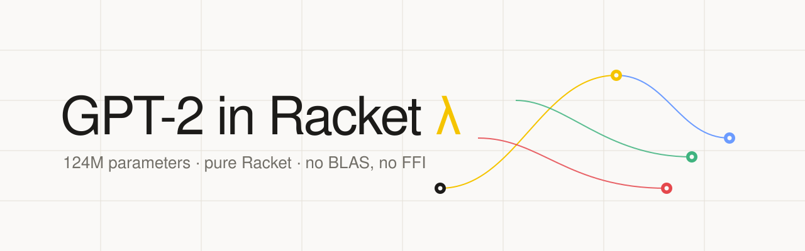
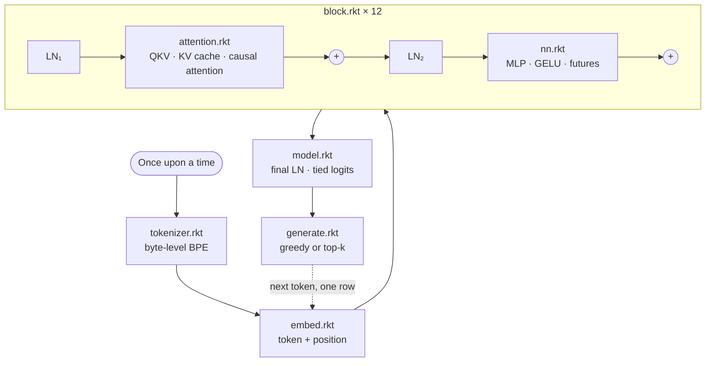

<picture>
  <source media="(prefers-color-scheme: dark)" srcset="docs/assets/banner-dark.svg">
  
</picture>

---

GPT-2 (124M) is small enough to read and large enough to talk. This repository is that model in Racket: the byte-level tokenizer, the safetensors loader, the transformer, and the sampler.

- **Arithmetic** is Racket flonums.
- **Parallelism** is Racket futures on Racket CS.
- **Nothing else runs**: no C extension, no BLAS, no FFI, no Python at runtime.
- **The weights** are the usual Hugging Face file.
- **Checked** against an eager PyTorch reference.

```text
$ racket main.rkt generate --model-dir models/gpt2 --prompt "Once upon a time" --max-new-tokens 16
, the world was a place of great beauty and great danger. The world was
```

> [!TIP]
> **[gpt2-rkt.vercel.app](https://gpt2-rkt.vercel.app)** walks through one forward pass of this engine. The write-up scrolls on one side, and a visualizer on the other replays a trace recorded from it, stage by stage, with the Racket that does each step. Its source is in [`site/`](site).

## Quickstart

You need the full [Racket CS 9.3](https://racket-lang.org/download/) distribution, so that `racket` and `raco` are on your `PATH`. The minimal install has no `raco test`.

```sh
sh tools/fetch-gpt2-vocab.sh        # pinned GPT-2 Small files, digests checked
racket main.rkt generate \
  --model-dir models/gpt2 \
  --prompt "Once upon a time" \
  --max-new-tokens 16
```

The text goes to stdout. Load time, memory, and tokens per second go to stderr. The weights are not in git. `GPT2_FETCH_WEIGHTS=0` fetches only the tokenizer and config.

The commands are POSIX shell, for Linux and macOS. On Windows, use Git Bash, WSL, or anything else with `sh` and `curl`. `racket main.rkt` itself is the same everywhere.

<details>
<summary><b>Sampling, limits, and calling it from Racket</b></summary>

<br>

Leave the sampling flags off for greedy decoding. To sample:

```sh
--temperature 0.8 --top-k 40 --seed 1
```

- **Temperature** must be a finite number greater than 0.
- **Top-k and seed** both need a temperature.
- **The seed** is an integer from 0 through 2147483647.
- **The prompt plus the new tokens** must fit in `min(1024, n_positions)`.
- **Generation stops** at the end-of-text token or at the requested count.

`racket main.rkt generate --help` lists every flag. A flag's value is the next argument, even if it starts with `-`.

From Racket, the three `#f` arguments leave out temperature, top-k, and seed, which means greedy decoding:

```racket
#lang racket/base
(require "main.rkt")

(define result
  (generate (generate-config "models/gpt2" "Once upon a time" 16 #f #f #f)))
(displayln (generation-text result))
```

It prints the new text, not the prompt. The continuation shown at the top is the checked reference in `tests/gpt2-small-cases.json`, not a fresh sample.

</details>

## How it works



The prompt is encoded with GPT-2's byte-level BPE. Token and position embeddings are added. Then come twelve pre-norm blocks, a final layer norm, and an output head tied to the token table. The first call fills a key/value cache sized to the request, and every later token runs as a single row. Sampling is greedy, or temperature with an optional top-k.

[Architecture](docs/ARCHITECTURE.md) walks through the whole thing, including the futures split and the memory choices.

### Where things are

| Path | What it is |
| --- | --- |
| [`main.rkt`](main.rkt) | The command line and the Racket API |
| [`src/tokenizer.rkt`](src/tokenizer.rkt) | Byte-pair encoding against GPT-2's ranked merges |
| [`src/safetensors.rkt`](src/safetensors.rkt) | Reads the 124M weights |
| [`src/embed.rkt`](src/embed.rkt) | Token and position embeddings |
| [`src/block.rkt`](src/block.rkt) | One transformer block, with the cache write |
| [`src/attention.rkt`](src/attention.rkt) | Causal attention, head by head |
| [`src/nn.rkt`](src/nn.rkt) | Matrix products, GELU, and the futures split |
| [`src/model.rkt`](src/model.rkt) | Twelve blocks, the final norm, the tied logits |
| [`src/generate.rkt`](src/generate.rkt) | The decode loop |
| [`tests/`](tests) | Checks against the PyTorch fixtures |
| [`bench/`](bench) | Timing harness and recorded results |
| [`site/`](site) | The write-up at [gpt2-rkt.vercel.app](https://gpt2-rkt.vercel.app) |

## Performance

Medians of three runs, each in a fresh process after one warmup. Greedy runs include the four-token prompt.

| Workload | Apple M5 Pro | Ryzen 5 8645HS |
| --- | ---: | ---: |
| Load the weights | 1.75 s | 3.09 s |
| Prefill, 128 tokens | 407 ms | 986 ms |
| Prefill, 1,000 tokens | 3.52 s | 11.46 s |
| **Greedy, 128 new tokens** | **34.3 tok/s** | **28.0 tok/s** |
| Matrix product 768 × 768 × 768 | 12.6 ms | 30.7 ms |

- **Apple M5 Pro** (6 performance and 12 efficiency cores, Racket 9.3 CS), measured on 25 November 2026 at `780d96d`. The raw results, plus the revision comparison and the worker sweep, are in [`bench/results/m5-pro-2026-11-25/`](bench/results/m5-pro-2026-11-25). The M5 run recorded the matrix product as 71.9 GFLOP/s, which is 12.6 ms for its 906 million floating-point operations.
- **Ryzen 5 8645HS** (12 logical processors, Windows, Racket CS 9.3), measured on 17 November 2026 on the current engine.

The full tables, the earlier comparisons, and what the counters mean are in [Benchmarks](docs/BENCHMARKS.md). To record your own machine, run `sh bench/run.sh`. Leave it idle for five minutes or more.

## Testing

`raco test .` runs the suite. Fetch the tokenizer, merges, and config first.

The real-weight comparison in `tests/gpt2-small.rkt` also needs `model.safetensors`, and skips itself when that file is missing. It checks hidden states, logits, and the greedy tokens against an eager fp32 fixture, within `|a − e| ≤ 1e-3 + 1e-4·|e|`. It also checks the full last row against a float64 copy.

CI runs both: one job fetches only the tokenizer, and another downloads the weights and runs the eager comparison. The fixtures were made by the Python under `tools/fixtures/`. The engine and the tests never call it.

## Limitations

- **No hardware acceleration:** arithmetic is Racket flonums, with no BLAS and no GPU.
- **Decoding:** greedy, or temperature with an optional top-k. There is no beam search.
- **Context:** `min(1024, n_positions)` tokens.
- **Inference only:** the engine doesn't train, and dropout is off.
- **Partial UTF-8 at the end:** a leftover partial UTF-8 sequence at the end of generation becomes one U+FFFD per unfinished byte.

More detail:
- the [0.1.0 notes](docs/RELEASE-v0.1.0.md);
- [Speed notes](docs/dev/speed.md), on what was tried and dropped;
- the [bug log](docs/BUGLOG.md), on the bugs that gave a wrong answer or a crash.

Supporting tools are in other languages:
- Python generates the reference fixtures;
- PowerShell coordinates the Windows benchmarks;
- shell scripts fetch assets and launch runs.

Tokenizing, loading, the model, and generation are all Racket.

---

<p align="center">
  Built by <a href="https://portfolio-v01-amber.vercel.app/#builds">Amaar</a> and <a href="https://abdullahehsan.vercel.app/projects">Abdullah</a>
  &nbsp;·&nbsp; <a href="LICENSE">MIT</a> &nbsp;·&nbsp; © 2026
</p>
