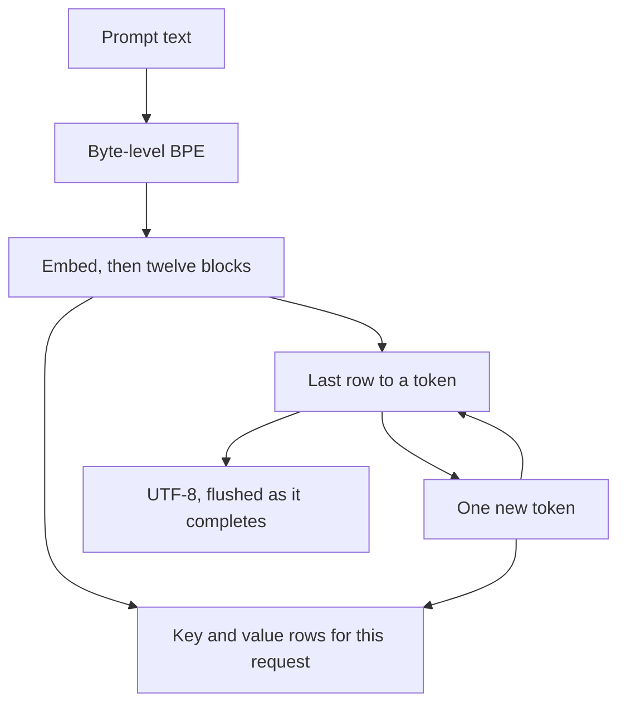

# Architecture

GPT-2 Small, as this repository runs it, is twelve pre-norm layers of width 768, twelve heads of width 64, and an MLP that expands to 3072. The vocabulary has 50,257 tokens. The context is 1,024 positions. End of text is token 50256. Those figures come from the pinned `config.json` (`n_inner` is missing there, so the loader uses `4 * n_embd`).

A prompt takes one path through the program.



The first forward pass is the prefill. Everything after that is a single new token, reading keys and values that are already stored.

## Tokenizer

GPT-2's BPE never sees a raw space or a control byte. Printable bytes stay themselves. Every other byte maps, in order, onto code points starting at U+0100. The pre-tokenizer is the usual GPT-2 split: contractions, then words, numbers, and punctuation, each allowed a leading space, then a run of whitespace. Racket's `pregexp` treats `\s` as ASCII, so the whitespace class is written out as the 25 Unicode White_Space characters the reference uses. Contractions are case-sensitive. `'m` merges and `'M` does not.

`<|endoftext|>` is scanned on the raw text before that split, because the regex would otherwise break it up. A prompt that contains the literal token encodes as 50256. `merges.txt` starts with `#version: 0.2`, and that line is not a merge. Rank 0 is the first real pair.

Decoding is the reverse map, then UTF-8. A token can end in the middle of a character, so those bytes stay buffered until the sequence is complete. Only the end of generation turns a leftover fragment into U+FFFD, one per unfinished byte.

## Weights

A model directory holds `config.json`, `vocab.json`, `merges.txt`, and `model.safetensors`. The fetch script pins `openai-community/gpt2` at `607a30d783dfa663caf39e06633721c8d4cfcd7e` and checks the digests in `tools/gpt2-assets.sha256`. `load-model` checks names and shapes. The digest check is the fetch script and `check-file-sha256`, which hashes the file from a port so the bytes are not held next to the model.

The safetensors reader takes the little-endian header length, a JSON header, and an F32 payload. The official header is 14,283 bytes, so the floats are not 4-byte aligned, and the reader accepts that. Anything that is not F32 is rejected by name. Tensor names may be bare, as in the published file, or prefixed with `transformer.`. `attn.bias` and `attn.masked_bias` are the stored mask buffers. They are skipped. The causal mask is computed. There is no `lm_head` in the published file. A copy that is identical to `wte` is accepted and ignored. A different tensor is an error. Logits are the hidden row dotted with each row of `wte`, which stays stored as `[vocab, 768]`. Nothing transposes that table.

## The block

Each block is pre-norm. The residual stream is the input, and each sublayer is added back onto it:

```
h = x + Attention(LayerNorm(x))
y = h + MLP(LayerNorm(h))
```

Layer norm uses the biased variance and epsilon `1e-5`. A constant row is exactly the bias. The attention projection is Hugging Face's Conv1D layout: a matrix of shape `[768, 2304]`, which is query, key, and value packed as three contiguous thirds, plus a bias. Head 0 is columns `[0, 64)`. The next head starts at column 64. Scores are scaled by `1/sqrt(64)`, which is 0.125. A key strictly after the query is omitted. The diagonal stays visible.

The MLP is the tanh GELU, not the erf one. `c_fc` maps 768 to 3072 and `c_proj` maps back. At input 1.0 the tanh approximation is 0.8411919906082768, which is the value the block test requires. Dropout is in the config and unused. The engine does not train.

After the twelve blocks, a final layer norm and the tied head produce the logits. Generation only needs the last row.

## The cache

A full forward pass on every new token would recompute keys and values the model has already seen. Each layer instead keeps two buffers, key and value, allocated once for the request. The capacity is the prompt length plus the number of new tokens you asked for, capped by the context. `next-token-logits`, which only scores a prompt, allocates the prompt length and nothing beyond it.

The cached block reads the query from the packed projection and writes the new key and value rows straight into those buffers. It does not build three separate tensors on that path. Attention then reads each head's columns in place, at a column offset, for the filled prefix only. The score scratch is one row per head, owned by the request and reused across queries and layers. There is no square score matrix.

The buffers are mutated in place, so a cache handle is single-use. Starting a forward clears it. The cache returned from that call is the one that continues. Passing the old handle again is an error, which is what you want: a second call would overwrite the rows just written.

Positions follow the filled length. Query row `i` sits at absolute position `filled - query_rows + i`.

## Sampling

With no temperature, the next token is the argmax. With a temperature, the row max is subtracted first, then the remainder is divided by the temperature. That keeps a tiny positive temperature from turning an all-negative row into infinities. Top-k, if you set it, keeps a heap of `k` ids. The root is the worst id still in the heap. Ties keep the lower id, the same order a stable sort of the whole vocabulary would have given, without sorting 50,257 logits. The kept ids go through a stable softmax, and one draw picks the token.

A seed builds a private random generator and does not touch the global one. The legal range is 0 through 2147483647, which is what `random-seed` accepts. Top-k 1 matches greedy. The same seed repeats.

The loop stops at the requested count or at end of text. The returned ids include that token. The printed text does not. Each piece is flushed as soon as its UTF-8 is complete.

The context check happens before any forward pass. 1,024 positions are legal. 1,025 are not. A shorter position table uses that length instead of 1,024.

## Parallelism and memory

Tensors are a shape plus one flvector, row-major. A reshape shares the flvector. A slice copies. The inner loops use unsafe flonum operations, and the Conv1D product walks each weight row contiguously: `y[n, out] = x[n, in] · W[in, out] + b[out]`.

A product whose work, `rows * inner * columns`, is under 100,000 stays on the calling thread. Future setup costs more than the arithmetic below that, which is where the per-head dots live. Larger products split into one future per processor. The split is across rows when there are at least 32 of them, and across output columns otherwise. The column split is what covers a single-token logits multiply, `1 x 768 x 50257`.

Two parameters, `current-decode-workers` and `current-prefill-workers`, can cap that split. `#f`, the default, means the host's `processor-count`. A positive integer is capped at that count. The decode parameter applies when the product has one row. The prefill parameter applies otherwise. They do not schedule attention heads. Heads get their own futures during prefill, when there is more than one processor and the head work exceeds the same 100,000 cutoff. A single new token stays serial.

On the laptop where the worker counts were measured, using all 12 logical processors was faster than 1, 2, 4, or 6 for greedy generation, a 128-token prefill, and the tied head. The default stays "all of them." The parameters are there so another machine can try a different budget. See [Benchmarks](BENCHMARKS.md).

Memory follows from the same choices. The file is F32. The live weights are flonums, so the resident set is larger than the file. On the cloud VM, after loading the earlier revision and forcing a collection, the process held 1,085,651,056 bytes. `load-model` itself does not collect. The benchmark does, and only then reads the resident size, so the dead file buffer is not part of that figure. The process peak still includes it. The exact peaks for that run are in [Benchmarks](BENCHMARKS.md).

The cache used to be a full 1,024 rows even for a short prompt. Twelve layers, two buffers, and 1,024 by 768 flonums is 150,994,944 bytes of zeros, and each decode step used to copy the filled key and value prefix out into fresh tensors. The request-sized buffers and the in-place column reads are what removed that. GELU and the residual add reuse the product buffer they just allocated. Inputs, and traces the block returns, are not used as scratch.

## What it does not do

There is no training, no beam search, no GPU, and no native math library. The agreement with the eager reference is a tolerance, not a bit match: the fp32 fixture allows `|a - e| <= 1e-3 + 1e-4 * |e|`. Block 11 is the widest gap against that fixture, at `1.09e-3`. A float64 copy of the same last rows matches to about `1e-13`. The gaps are written up in the [0.1.0 notes](RELEASE-v0.1.0.md).
